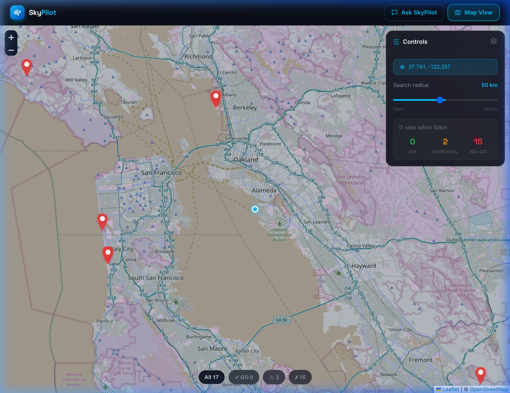
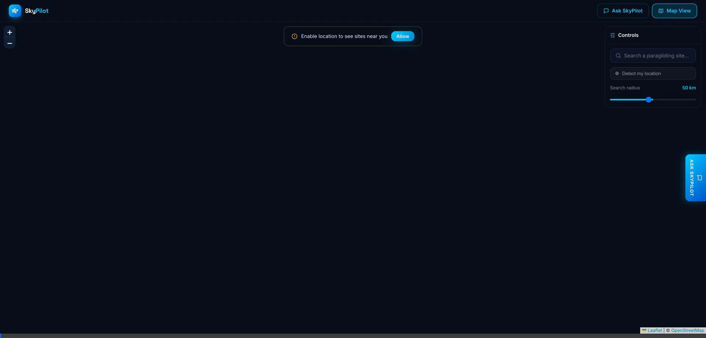
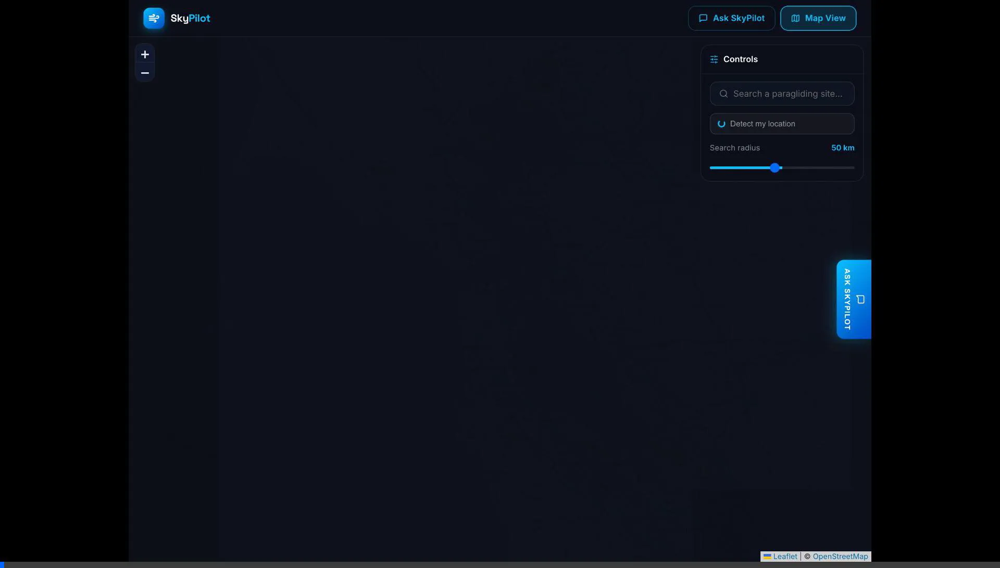
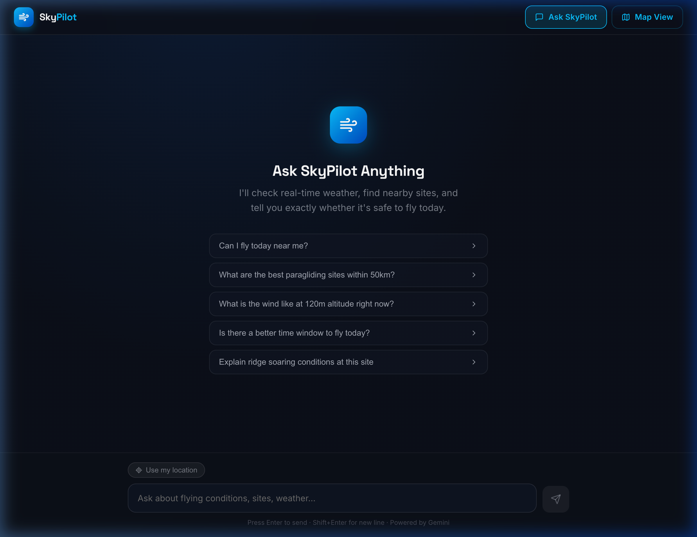
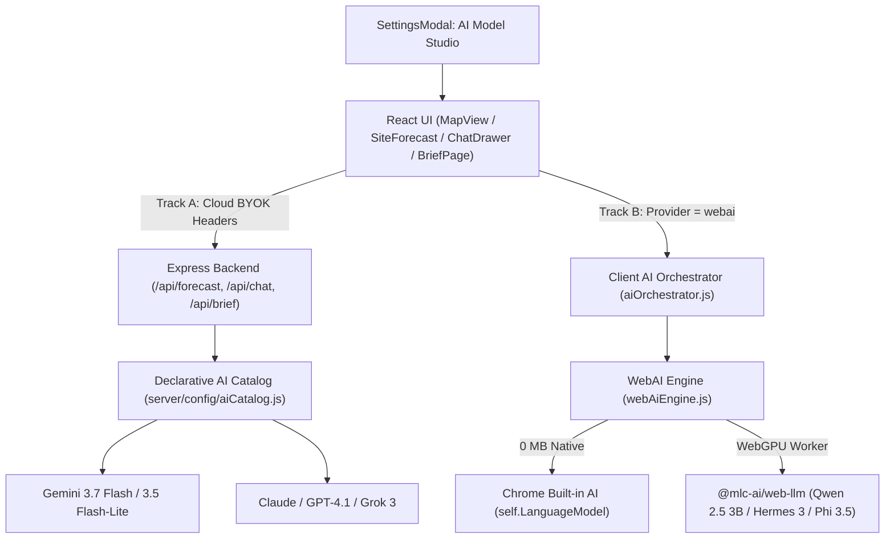

# 🪂 SkyPilot — AI Paragliding Assistant

SkyPilot is a full-stack AI-powered paragliding conditions advisor. It helps pilots evaluate whether conditions are safe to fly at paragliding sites near them. By combining real-time multi-altitude weather data from Open-Meteo, resilient 3-tier launch site discovery, and your choice of **100% Free On-Device Browser AI (WebAI)** or **Cloud BYOK LLMs (Gemini 3.7 Flash, Gemini 3.5 Flash-Lite, Claude, GPT, Grok)**, SkyPilot provides clear **GO / MARGINAL / NO-GO** assessments, interactive maps, and conversational advice.

## 📸 Screenshots & Walkthrough

| Map View & Controls | Forecast & Model Selection |
|----------|----------------------------|
|  |  |
| **Site Lookup & Detailed Forecast** | **Conversational Agent** |
|  |  |

---

## 🚀 Key Features

- **Resilient 3-Tier Site Discovery:** Automatically discovers free-flight launches via ParaglidingEarth, OpenStreetMap Overpass API (`sport=free_flying`), and a curated global launch catalog (`server/data/fallbackSites.json`) so the map never fails even if an upstream directory is under maintenance.
- **Flagship AI Model Studio (On-Device WebAI + Cloud BYOK):**
  - **🟢 Free On-Device AI (WebAI):** Run open-source models 100% locally in your browser via WebGPU (`@mlc-ai/web-llm`) or **Chrome Built-in AI (`Gemini Nano` — 0 MB download)** with zero API keys or subscription costs. Includes hardware-aware model recommendations (`Qwen 2.5 3B`, `Hermes 3 Llama 3.2 3B`, `Qwen 2.5 1.5B`, `Phi 3.5 Mini`), live download progress, and 1-click cache cleanup.
  - **🔑 Cloud API Keys (BYOK):** Connect your own API key for Google Gemini (**`gemini-3.7-flash`** & **`gemini-3.5-flash-lite`**), Anthropic Claude (`Haiku 4.5` & `Sonnet 4.5`), OpenAI (`GPT-4.1 Mini` & `GPT-4.1`), or xAI (`Grok 3 Mini` & `Grok 3`). Keys stay strictly in your browser's `localStorage`.
- **Hourly & 7-Day Forecasts:** Detailed breakdowns of wind by altitude (`33ft`, `262ft`, `394ft`, `591ft` AGL), wind direction alignment, gusts, and 7-day heatmaps.
- **Favorites & Morning Brief:** Star your favorite paragliding sites and receive a regional morning briefing ranking nearby sites for the day.
- **Site-Specific AI Chat:** Ask questions like *"Can I fly Mussel Rock today?"* or *"When is the best window this week?"* with live telemetry and streaming responses.

---

## 🤖 Supported AI Models

| Track | Provider | Models | Cost / Key |
| :--- | :--- | :--- | :--- |
| **On-Device (Browser)** | **Chrome Built-in AI** | `chrome-built-in` (Gemini Nano) | **Free · 0 MB Download · No Key** |
| **On-Device (WebGPU)** | **WebLLM (MLC)** | `Qwen 2.5 3B` (★ Recommended), `Hermes 3 3B`, `Qwen 2.5 1.5B`, `Phi 3.5 Mini` | **Free · Cached in Browser · No Key** |
| **Cloud BYOK** | **Google Gemini** | `gemini-3.5-flash-lite` (★ Default), `gemini-3.7-flash`, `gemini-2.5-flash` | Free Tier / BYOK |
| **Cloud BYOK** | **Anthropic Claude** | `claude-haiku-4-5-20251001`, `claude-sonnet-4-5-20250929` | BYOK |
| **Cloud BYOK** | **OpenAI** | `gpt-4.1-mini`, `gpt-4.1` | BYOK |
| **Cloud BYOK** | **xAI Grok** | `grok-3-mini`, `grok-3` | BYOK |

---

## 🛠️ Developer Setup

This project uses a monorepo structure with a **React (Vite + PWA)** frontend and a **Node.js (Express)** backend.

### Prerequisites
- Node.js (v18+)
- Modern browser (Chrome/Edge 113+ recommended for WebGPU / Built-in AI)

### 1. Install Dependencies

```bash
npm install
cd server && npm install
cd ../client && npm install
```

### 2. Run the Development Servers

From the project root:

```bash
npm run dev
```

- **Frontend Application:** `http://localhost:5173`
- **Backend API:** `http://localhost:3001`

### 3. Run Tests & Full Verification

```bash
npm test          # Runs Node.js unit & integration test suite
npm run verify    # Runs tests + builds production Vite/PWA bundle
```

---

## 🏗️ Architecture Overview



### 3-Tier Site Discovery (`server/tools/getSites.js`)
1. **Tier 1 — ParaglidingEarth GeoJSON API:** Queries nearby launches with wind direction ratings (`0–2`).
2. **Tier 2 — OpenStreetMap Overpass API:** Queries `sport=free_flying` launches when ParaglidingEarth is unreachable or in maintenance, merged with curated regional sites.
3. **Tier 3 — Curated Fallback Database (`server/data/fallbackSites.json`):** Ensures major US and international flying sites are always available offline or during upstream outages.
